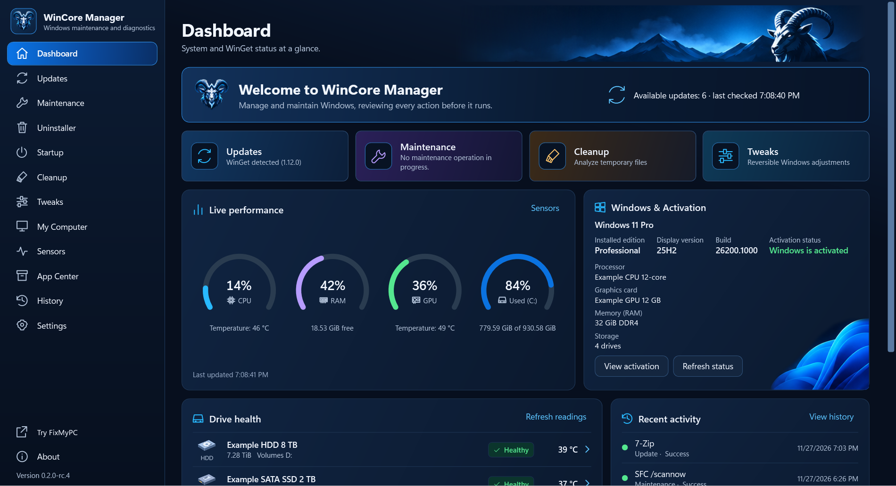
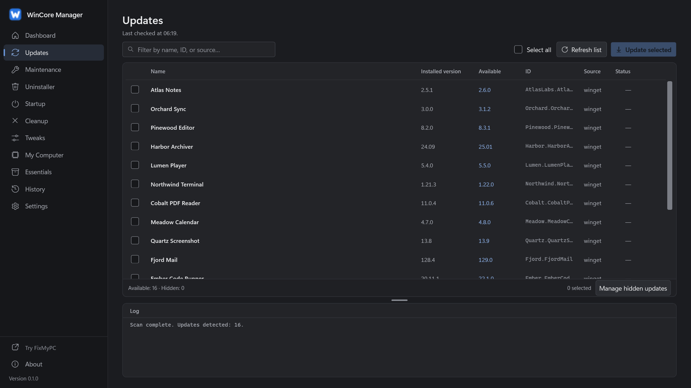

English | [Português (Brasil)](docs/README.pt-BR.md)

# WinCore Manager

A Windows desktop utility for supervised system management and maintenance, built with C#, WPF and .NET 10.


[](LICENSE)

## Overview

WinCore Manager brings common Windows maintenance tasks into one interface: application updates through WinGet, uninstalling, startup entries, cleanup, settings and hardware information. It favors clarity and control. You see what will happen, confirm changes and can review the results afterwards.

It does not promise automatic optimization or guaranteed fixes.

## Screenshots

Both images are real renders of the application, filled with synthetic demonstration data. The application names, versions, history entries, and the WinGet and Windows activation details shown are fictitious, and no operation was performed.

### Dashboard



### Updates



## Features

| Area | What it does |
| --- | --- |
| Dashboard | Update and maintenance status, recent activity, Windows edition and activation status with a shortcut to Windows activation settings. |
| Updates | Lists application updates through WinGet, updates selected packages under supervision, hides updates you do not want, and offers supervised recovery of interrupted operations. |
| Maintenance | Runs a fixed set of Windows tools: SFC, DISM RestoreHealth, CHKDSK `/scan`, DNS flush, and a combined DISM + SFC repair. |
| Uninstaller | Lists installed programs with search and categories, runs uninstallers one at a time, and scans for leftovers with backup before removal. |
| Startup | Shows what starts with Windows and lets you enable or disable eligible personal entries. |
| Cleanup | Shows space used on the Windows volume, opens Windows Disk Cleanup and empties the Recycle Bin after confirmation. |
| Tweaks | Shows current power timeouts, visual effects and File Explorer options, applies changes on request, undoes the last change and links to System Protection. |
| My Computer | Read-only hardware inventory and sensor readings, where the hardware and permissions allow it. |
| Essentials | A curated list of components, drivers and tools. Each entry opens a web page in your browser; nothing is installed by WinCore Manager. |
| History | A local, searchable record of operations and their results, with retention settings. |
| Settings | Light and Dark themes, English (US) and Portuguese (Brazil), portable mode, history retention and WinGet options. |
| About | Version, credits and licenses. |

When Windows is reported as not activated, the Dashboard also offers, after a confirmation, to open the repository of Microsoft Activation Scripts (MAS), a third-party project that is not affiliated with Microsoft or WinCore Manager. WinCore Manager only opens that web page in your browser: it does not download, include or run any activation script. The project has its own license, the MIT license here does not cover it, and using it may breach Microsoft's license terms. Use only properly licensed copies of Windows.

In-app self-update of WinCore Manager itself is present in the code but **not enabled**: no official release channel or publisher key is configured.

## Requirements

**To run the portable package**

- 64-bit Windows 10 or Windows 11.
- WinGet (Microsoft App Installer) for the Updates area.
- No separate .NET installation: the portable package is self-contained.
- Administrator approval for the operations that need it.

**To build from source**

- Windows x64.
- [.NET 10 SDK](https://dotnet.microsoft.com/download/dotnet/10.0), which includes what is needed to build WPF projects.
- Internet access to restore NuGet packages.

## Running the portable package

Download `WinCoreManager-0.1.0-win-x64-portable.zip` from the [Releases](https://github.com/rsehenth/WinCore-Manager/releases) page, extract it to a local folder you can write to and run `WinCoreManager.exe`. The binaries are not code-signed, so Windows SmartScreen may warn you. Compare the file's SHA-256 hash with the one published with the release.

## Building from source

Run these from the repository root.

```powershell
dotnet restore WinCoreManager.sln
```

```powershell
dotnet build WinCoreManager.sln -c Release --no-restore
```

```powershell
dotnet test WinCoreManager.sln -c Release --no-build -- xUnit.ParallelizeTestCollections=false
```

Run the tests serially, as shown: they share WPF and language state, and parallel runs fail. Three cross-volume tests are skipped unless `WINCORE_QUARANTINE_SECOND_VOLUME` points to a folder on a local NTFS volume other than the one holding `TEMP`.

### Publishing a portable build

```powershell
dotnet publish src/WinCoreManager/WinCoreManager.csproj -c Release -r win-x64 --self-contained -o artifacts/portable
```

```powershell
Set-Content artifacts/portable/settings.json '{"PortableMode":true}'
```

The publish output already contains the license files. This produces a working portable application. It does not include the update helper, the independent Recovery assistant or the package manifest. Those are assembled by the maintainer script `tools/New-PortableCandidate.ps1`, which also needs a test selection file and a two-volume test host.

## WinGet limitations

- Only the official `winget` and `msstore` sources are used.
- **Updating a package accepts its source and package agreements automatically** and runs without WinGet prompts. Review the terms of what you select.
- Updates are refused while WinCore Manager itself is running elevated. Installers may still ask for administrator approval.
- Packages whose installed version is unknown are not updated, except for a narrowly verified Battle.net case that asks for confirmation.
- A package can be refused when its installer metadata cannot be verified.
- Canceling may have to wait for the current step. An installer outside WinCore Manager's control can keep running.
- Some updates require a Windows restart or a manual review before further package changes.

## Safety and operation

- Changes with real effect ask for confirmation where applicable.
- Some operations require elevated privileges.
- Third-party installers and uninstallers run their own code and are not fully under WinCore Manager's control.
- An operation whose outcome cannot be determined may require supervised review before further changes.
- Keep a backup before making changes to Windows. No tool can guarantee that a change is safe on every system.

See also [recovery instructions](tasks/RECUPERACAO-RECOVERY.md) for interrupted application updates of a portable package.

## Privacy and local data

WinCore Manager has no account system, and no telemetry or analytics code was found in the source. Network access happens when WinGet contacts its sources and when the application reads WinGet package manifests from Microsoft's package services and the `winget-pkgs` repository. Links you open go to your default browser.

| Data | Purpose | Location |
| --- | --- | --- |
| `settings.json` | Preferences and hidden updates | Next to the executable in portable mode, otherwise `%LOCALAPPDATA%\WinCoreManager` |
| `history.db` (SQLite) | Operation history | `Data\` next to the executable in portable mode, otherwise `%LOCALAPPDATA%\WinCoreManager` |
| `winget-update.json` | Receipt of an update in progress, for recovery | `%LOCALAPPDATA%\WinCoreManager`, also in portable mode |
| Quarantine | Backups of removed leftovers | Under the data folder or `%LOCALAPPDATA%\WinCoreManager\Quarantine` |
| Startup backups | Restoring disabled startup entries | `%APPDATA%\WinCoreManager\StartupBackups` and `%LOCALAPPDATA%\WinCoreManager\StartupRunBackups` |
| Tweak journal | Undoing the last tweak | `%LOCALAPPDATA%\WinCoreManager\Tweaks` |

Because some data stays in the user profile, deleting a portable folder does not remove everything.

## Project status

**WinCore Manager 0.1.0** is published as a pre-release for supervised personal use. It is not yet a stable release. Full validation of third-party installers and of native DPI behavior across multiple monitors still has documented limitations.

## Contributing and security

See [CONTRIBUTING.md](CONTRIBUTING.md), [SECURITY.md](SECURITY.md) and the [changelog](CHANGELOG.md). Source comments, test names and internal messages are mostly written in Portuguese.

## Credits

- [Bulk Crap Uninstaller](https://github.com/BCUninstaller/Bulk-Crap-Uninstaller) by Marcin Szeniak (Klocman): parts of the uninstaller code are adapted from it (Apache-2.0).
- .NET, WPF, CommunityToolkit.Mvvm, Microsoft.Data.Sqlite, Microsoft.Extensions.DependencyInjection and System.Management.
- SQLite, SQLitePCLRaw and YamlDotNet.
- xUnit for tests.

Created by [Lucas Sehnem](https://github.com/rsehenth).

## License

The original WinCore Manager code is released under the [MIT License](LICENSE) (SPDX: `MIT`). Third-party components and adapted code keep their own licenses; see [THIRD-PARTY-NOTICES.md](THIRD-PARTY-NOTICES.md).
