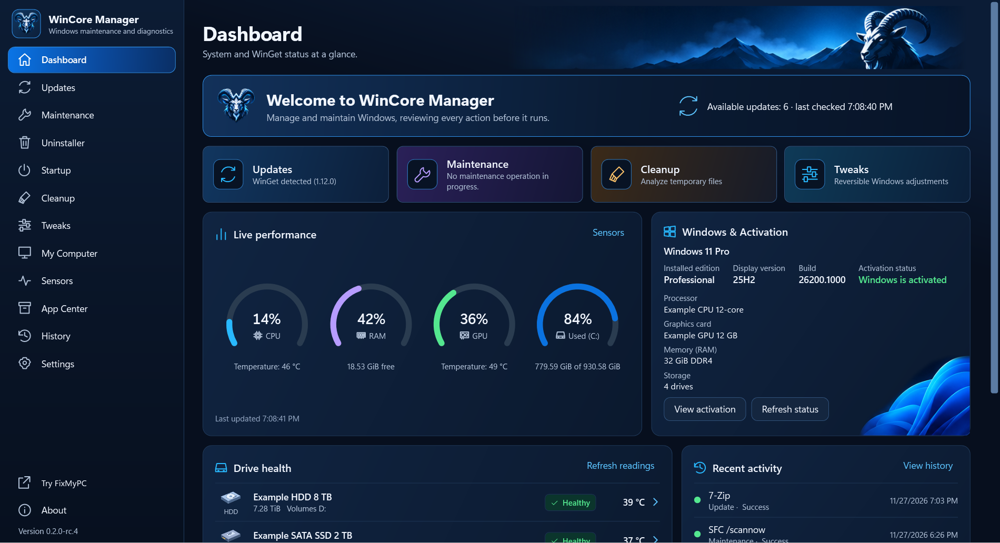
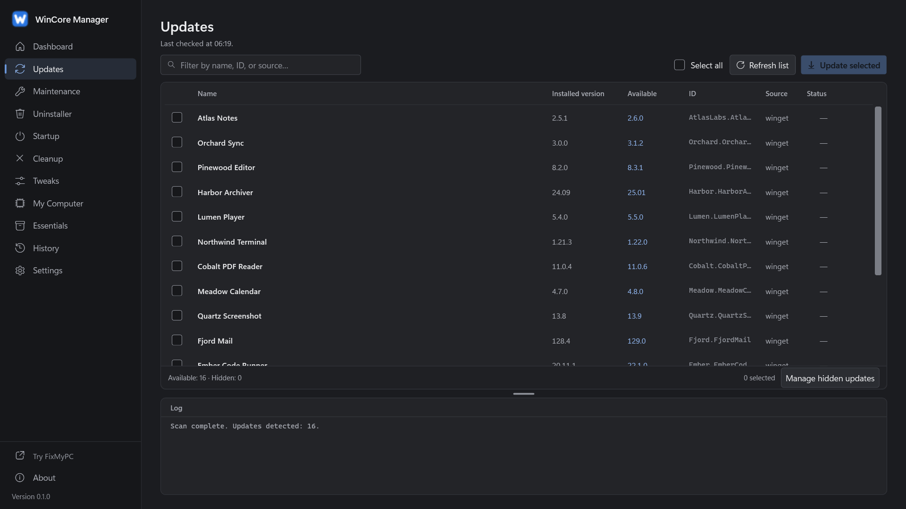

[English](../README.md) | Português (Brasil)

# WinCore Manager

Utilitário desktop para Windows voltado ao gerenciamento e à manutenção supervisionada do sistema, criado com C#, WPF e .NET 10.


[](../LICENSE)

## Visão geral

O WinCore Manager reúne em uma interface tarefas comuns de manutenção do Windows: atualização de aplicativos pelo WinGet, desinstalação, itens de inicialização, limpeza, ajustes e informações de hardware. A prioridade é clareza e controle. Você vê o que vai acontecer, confirma as alterações e pode revisar os resultados depois.

Ele não promete otimização automática nem solução garantida de problemas.

## Screenshots

As duas imagens são renderizações reais do aplicativo, preenchidas com dados sintéticos de demonstração. Os nomes de aplicativos, versões, registros de histórico e os dados de WinGet e de ativação do Windows são fictícios, e nenhuma operação foi executada. A interface aparece em inglês.

### Painel



### Atualizações



## Funcionalidades

| Área | O que faz |
| --- | --- |
| Painel | Situação de atualizações e manutenção, atividade recente, edição e ativação do Windows com atalho para as configurações de ativação. |
| Atualizações | Lista atualizações de aplicativos pelo WinGet, atualiza os pacotes selecionados com supervisão, oculta atualizações indesejadas e oferece recuperação supervisionada de operações interrompidas. |
| Manutenção | Executa um conjunto fixo de ferramentas do Windows: SFC, DISM RestoreHealth, CHKDSK `/scan`, limpeza do cache DNS e reparo combinado DISM + SFC. |
| Desinstalador | Lista programas instalados com busca e categorias, executa desinstaladores um por vez e procura resíduos, com backup antes da remoção. |
| Inicializar | Mostra o que inicia com o Windows e permite ativar ou desativar itens pessoais elegíveis. |
| Limpeza | Mostra o espaço usado no volume do Windows, abre a Limpeza de Disco do Windows e esvazia a Lixeira após confirmação. |
| Tweaks | Mostra tempos de energia, efeitos visuais e opções do Explorador de Arquivos, aplica alterações a pedido, desfaz a última e dá acesso à Proteção do Sistema. |
| Meu Computador | Inventário de hardware somente leitura e leitura de sensores, quando o hardware e as permissões permitem. |
| Essenciais | Lista selecionada de componentes, drivers e ferramentas. Cada item abre uma página no navegador; o WinCore Manager não instala nada. |
| Histórico | Registro local e pesquisável das operações e resultados, com configuração de retenção. |
| Configurações | Temas Light e Dark, português (Brasil) e inglês (EUA), modo portátil, retenção do histórico e opções do WinGet. |
| Sobre | Versão, créditos e licenças. |

Quando o Windows aparece como não ativado, o Painel também oferece, após confirmação, abrir o repositório do Microsoft Activation Scripts (MAS), um projeto de terceiros sem vínculo com a Microsoft ou com o WinCore Manager. O WinCore Manager apenas abre essa página no navegador: não baixa, não inclui nem executa script de ativação. O projeto tem licença própria, a licença MIT daqui não se aplica a ele, e usá-lo pode violar os termos de licença da Microsoft. Use apenas cópias devidamente licenciadas do Windows.

A atualização automática do próprio WinCore Manager existe no código, mas **não está habilitada**: não há canal oficial de releases nem chave de publicador configurados.

## Requisitos

**Para executar o pacote portátil**

- Windows 10 ou Windows 11 de 64 bits.
- WinGet (Instalador de Aplicativo da Microsoft) para a área de Atualizações.
- Nenhuma instalação separada do .NET: o pacote portátil é autossuficiente.
- Aprovação de administrador nas operações que exigem.

**Para compilar o código-fonte**

- Windows x64.
- [SDK do .NET 10](https://dotnet.microsoft.com/download/dotnet/10.0), que inclui o necessário para compilar projetos WPF.
- Acesso à internet para restaurar os pacotes NuGet.

## Como executar o pacote portátil

Baixe `WinCoreManager-0.1.0-win-x64-portable.zip` na página de [Releases](https://github.com/rsehenth/WinCore-Manager/releases), extraia em uma pasta local com permissão de gravação e execute `WinCoreManager.exe`. Os binários não têm assinatura de código, então o SmartScreen do Windows pode exibir um aviso. Compare o SHA-256 do arquivo com o publicado na release.

## Como compilar

Execute a partir da raiz do repositório.

```powershell
dotnet restore WinCoreManager.sln
```

```powershell
dotnet build WinCoreManager.sln -c Release --no-restore
```

```powershell
dotnet test WinCoreManager.sln -c Release --no-build -- xUnit.ParallelizeTestCollections=false
```

Execute os testes em série, como acima: eles compartilham o estado do WPF e do idioma, e a execução paralela falha. Três testes entre volumes são ignorados, a menos que `WINCORE_QUARANTINE_SECOND_VOLUME` aponte para uma pasta em um volume NTFS local diferente daquele que contém `TEMP`.

### Como publicar uma build portátil

```powershell
dotnet publish src/WinCoreManager/WinCoreManager.csproj -c Release -r win-x64 --self-contained -o artifacts/portable
```

```powershell
Set-Content artifacts/portable/settings.json '{"PortableMode":true}'
```

A saída da publicação já contém os arquivos de licença. O resultado é um aplicativo portátil funcional. Ele não inclui o atualizador auxiliar, o assistente de Recovery independente nem o manifesto do pacote. Esses itens são montados pelo script do mantenedor `tools/New-PortableCandidate.ps1`, que também exige um arquivo de seleção de testes e um host de testes com dois volumes.

## Limitações do WinGet

- Somente as fontes oficiais `winget` e `msstore` são usadas.
- **Atualizar um pacote aceita automaticamente os termos da fonte e do pacote** e executa sem perguntas do WinGet. Revise os termos do que você selecionar.
- Atualizações são recusadas enquanto o próprio WinCore Manager estiver elevado. Os instaladores ainda podem pedir aprovação de administrador.
- Pacotes com versão instalada desconhecida não são atualizados, exceto em um caso do Battle.net verificado de forma restrita, que pede confirmação.
- Um pacote pode ser recusado quando os metadados do instalador não podem ser verificados.
- O cancelamento pode precisar esperar a etapa atual. Um instalador fora do controle do WinCore Manager pode continuar em execução.
- Algumas atualizações exigem reiniciar o Windows ou uma revisão manual antes de novas alterações em pacotes.

## Segurança e funcionamento

- Alterações com efeito real pedem confirmação quando aplicável.
- Algumas operações precisam de privilégios elevados.
- Instaladores e desinstaladores de terceiros executam código próprio e não ficam sob controle integral do WinCore Manager.
- Uma operação com resultado inconclusivo pode exigir revisão supervisionada antes de novas alterações.
- Tenha um backup antes de alterar o Windows. Nenhuma ferramenta garante que uma alteração seja segura em qualquer sistema.

Veja também as [instruções de recuperação](../tasks/RECUPERACAO-RECOVERY.md) para atualizações interrompidas do pacote portátil.

## Privacidade e persistência

O WinCore Manager não tem sistema de contas, e não foi encontrado código de telemetria ou analytics no código-fonte. Há acesso à rede quando o WinGet consulta suas fontes e quando o aplicativo lê manifestos de pacotes do WinGet nos serviços de pacotes da Microsoft e no repositório `winget-pkgs`. Os links abertos vão para o navegador padrão.

| Dados | Finalidade | Localização |
| --- | --- | --- |
| `settings.json` | Preferências e atualizações ocultas | Ao lado do executável no modo portátil; caso contrário, `%LOCALAPPDATA%\WinCoreManager` |
| `history.db` (SQLite) | Histórico de operações | `Data\` ao lado do executável no modo portátil; caso contrário, `%LOCALAPPDATA%\WinCoreManager` |
| `winget-update.json` | Recibo de atualização em andamento, para recuperação | `%LOCALAPPDATA%\WinCoreManager`, inclusive no modo portátil |
| Quarentena | Backups de resíduos removidos | Na pasta de dados ou em `%LOCALAPPDATA%\WinCoreManager\Quarantine` |
| Backups de inicialização | Restaurar itens desativados | `%APPDATA%\WinCoreManager\StartupBackups` e `%LOCALAPPDATA%\WinCoreManager\StartupRunBackups` |
| Diário de ajustes | Desfazer o último ajuste | `%LOCALAPPDATA%\WinCoreManager\Tweaks` |

Como parte dos dados fica no perfil do usuário, apagar a pasta portátil não remove tudo.

## Estado do projeto

**WinCore Manager 0.1.0** está publicado como pré-lançamento para uso pessoal supervisionado. Ainda não é uma release estável. A homologação completa de instaladores externos e do comportamento de DPI nativo entre monitores ainda tem limitações documentadas.

## Contribuição e segurança

Veja [CONTRIBUTING.md](../CONTRIBUTING.md), [SECURITY.md](../SECURITY.md) e o [changelog](../CHANGELOG.md). Comentários, nomes de testes e mensagens internas estão em grande parte em português.

## Créditos

- [Bulk Crap Uninstaller](https://github.com/BCUninstaller/Bulk-Crap-Uninstaller), de Marcin Szeniak (Klocman): partes do desinstalador são adaptadas dele (Apache-2.0).
- .NET, WPF, CommunityToolkit.Mvvm, Microsoft.Data.Sqlite, Microsoft.Extensions.DependencyInjection e System.Management.
- SQLite, SQLitePCLRaw e YamlDotNet.
- xUnit nos testes.

Criado por [Lucas Sehnem](https://github.com/rsehenth).

## Licença

O código original do WinCore Manager é distribuído sob a [Licença MIT](../LICENSE) (SPDX: `MIT`). Componentes de terceiros e código adaptado mantêm suas próprias licenças; veja [THIRD-PARTY-NOTICES.md](../THIRD-PARTY-NOTICES.md).
